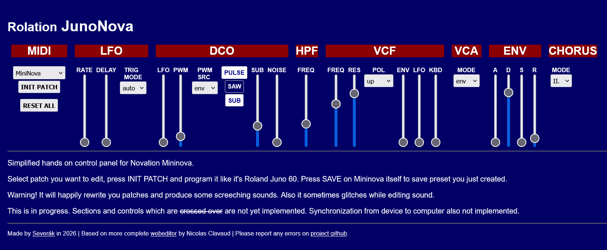

# JunoNova

*There is a Juno 60 hidden in every Mininova behind the endless menu dive.*

Simplified hands on control panel for Novation Mininova. Select patch you want to edit, press INIT PATCH and program it like it's Roland Juno 60.

## credits

Made by Severák in 2026 without using AI - I learned a lot of about Mininova MIDI inner workings, CCs and NRPNs.

Based on more complete web-editor by Nicolas Clavaud - https://github.com/nclavaud/mininova-web-editor/